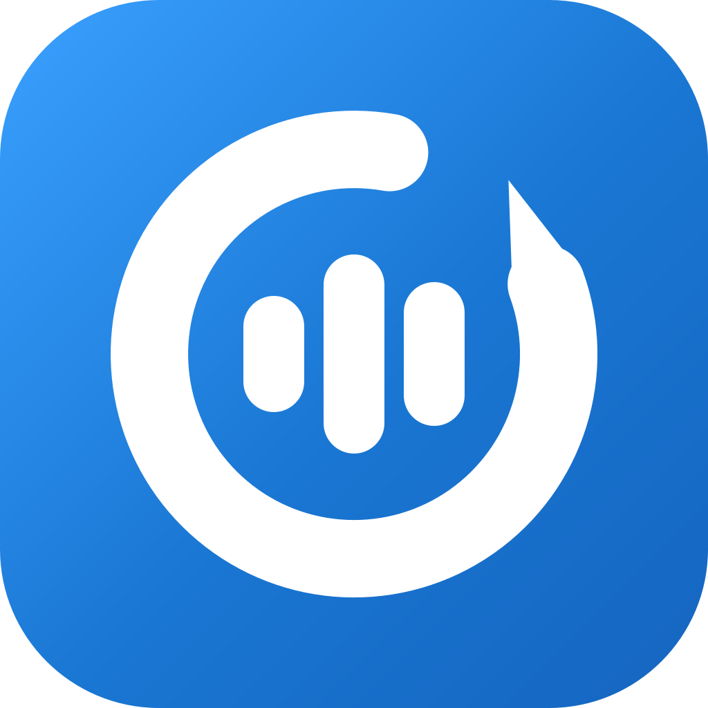
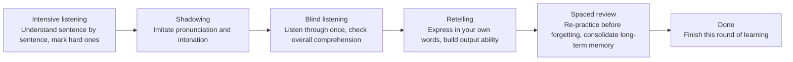

<div align="right">
  <strong>English</strong> | <a href="./README.md">简体中文</a>
</div>

<div align="center">
  

  <h1>LoopBack — English Listening & Speaking Training</h1>

  <p><strong>Pick an audio clip you want to understand, and practice it from comprehension to output.</strong></p>

  <p>Intensive listening · Shadowing · Blind listening · Retelling · Spaced review — LoopBack schedules every step; you just practice.</p>

  <p>
    <a href="./LICENSE"></a>
    
    <a href="https://github.com/iron6909/loop-back/releases/latest"></a>
    <a href="https://github.com/iron6909/loop-back/releases"></a>
    <a href="https://github.com/iron6909/loop-back/commits/main"></a>
  </p>

</div>

---

## ⚖️ Origin & license

LoopBack is a modified version of the open-source project [Echo Loop](https://github.com/echo-loop/Echo-Loop) (GNU AGPL-3.0). Modifications started in November 2026. Key changes:

- Rebranded to LoopBack: app name, package IDs, icon, database and local files all renamed;
- De-clouded: accounts, membership checkout, cloud subtitles, community sync, cloud-drive import and self-update are disabled;
- AI now connects directly to a provider configured by the user (OpenAI-compatible API), billed by that provider under its own plans;
- Speech recognition, speech synthesis, dictionary and pronunciation packs are downloaded from public sources (Hugging Face, etc.) instead of Echo Loop's resource service;
- Not distributed through app stores; Android APKs ship via GitHub Releases.

Under AGPL-3.0, this project as a whole remains licensed under AGPL-3.0 — see [LICENSE](./LICENSE). All changes to and additions on top of the upstream code are public in this repository. Thanks to the Echo Loop developers and community.

---

## 📖 What is LoopBack

LoopBack is an open-source app for practicing English listening and speaking. Import an audio clip — a podcast, TED talk, TV episode or textbook — and it walks you through **intensive listening → shadowing → blind listening → retelling**, then locks the material in with **spaced review** before you forget it.

Most material apps give you content and tools but leave the *how* to you. LoopBack automates that part: which clip to practice today, how many passes, when to look at subtitles, which sentences need more shadowing, when to review — the app decides. No planning needed; open it and start.

The whole process is quantified: **practice time · input/output ratio · unique vocabulary** — you can see exactly how much you've practiced and spoken.

---

## 📱 Screenshots

<table>
  <tr>
    <td align="center"><br/><sub>Import audio, start practicing</sub></td>
    <td align="center"><br/><sub>Learning plan, listen-speak loop</sub></td>
    <td align="center"><br/><sub>Review reminders, auto-scheduled</sub></td>
    <td align="center"><br/><sub>Sentence-by-sentence intensive listening</sub></td>
    <td align="center"><br/><sub>Sentence explanation, sense groups</sub></td>
  </tr>
  <tr>
    <td align="center"><br/><sub>Retelling: say it in your own words</sub></td>
    <td align="center"><br/><sub>Saved hard sentences, focused drills</sub></td>
    <td align="center"><br/><sub>Flashcard review, original context</sub></td>
    <td align="center"><br/><sub>Freestyle listening, your own pace</sub></td>
    <td align="center"></td>
  </tr>
</table>

---

## ✨ Features

- **Auto-driven learning rhythm**: Shadowing repetitions, review timing and hard-sentence marking advance automatically — you just listen and speak.
- **Listen-speak loop**: Intensive listening, shadowing and retelling in one flow — understand first, imitate next, then say it in your own words.
- **Sense-group splitting for long sentences**: Long sentences are split by sense groups so complex structures become digestible.
- **Save hard sentences and drill them**: Hard sentences are auto-archived for focused re-practice — no more "marked and forgotten".
- **Contextualized flashcard review**: Saved words and sense groups are reviewed with their original sentence context — memorize in context, not in isolation.
- **AI translation, analysis and vocabulary help**: Bilingual translation, sentence analysis, word usage and collocations, expanded on demand without breaking your flow.
- **Resume where you left off**: Your stage and current sentence are saved automatically, so even a 5-minute break fits.
- **Learning statistics**: Practice time, input/output ratio and unique vocabulary.
- **Shadowing evaluation**: On-device recognition is aligned with the original text, matched words are highlighted, and you get a rating.
- **Local audio import + subtitles**: Batch-import local audio, bring your own subtitles, or transcribe with an on-device model.

---

## 🔌 AI provider & localization notes

AI features use a provider you configure. On first use, go to **Settings → AI service**, choose DeepSeek, OpenRouter or a custom OpenAI-compatible endpoint, enter a model and API key, and verify the connection manually. The base URL receives `/chat/completions` directly; `/v1` is never appended automatically. Keys stay in device secure storage, are excluded from backups, and must be re-entered after restoring a backup.

Subtitle and retelling transcription run with an on-device English model; the study assistant and explanation requests go to the current provider. Accounts, membership, cloud subtitles, community sync, cloud-drive import and self-update are disabled. Existing learning data stays available; local folders can be imported as collections, and curated podcasts ship in the bundle.

---

## 🧠 Methodology

**Intensive listening → Shadowing → Blind listening → Retelling → Spaced review → Done.**



Each material = 1 first-pass session + 7 spaced reviews, with intervals stretching from 6 hours to 28 days:

| Stage | Interval since last | Tasks |
|---|---|---|
| First pass | — | Intensive → Shadowing → Blind → Retelling |
| Review 1 | After 6 hours | Hard-sentence drills + retelling |
| Review 2 | After 1 day | Blind listening + drills + retelling |
| Review 3 | After 2 days | Blind listening + drills + retelling |
| Review 4 | After 4 days | Blind listening + drills + retelling |
| Review 5 | After 7 days | Blind listening + drills + retelling |
| Review 6 | After 14 days | Blind listening + drills + retelling |
| Review 7 | After 28 days | Blind listening + drills + retelling |

---

## 🆚 How it differs from other apps

Compared with other English-learning apps, LoopBack's difference is this: **it strings the steps into one auto-driven flow — no planning, counting repetitions or tracking review dates yourself.**

| Feature | LoopBack | Daily English Listening | Kekenet | Liulishuo | Anki |
|---|---|---|---|---|---|
| App-driven learning rhythm | ✅ Fully automatic | ❌ | ❌ | ❌ | ❌ |
| Intensive + shadowing + retelling loop | ✅ | ⚠️ Partial | ⚠️ Partial | ⚠️ Partial | ❌ |
| Sense-group splitting for long sentences | ✅ | ❌ | ❌ | ❌ | ❌ |
| Saved-sentence focused review | ✅ | ❌ | ❌ | ❌ | ❌ |
| Contextualized flashcard review | ✅ | ❌ | ❌ | ❌ | ⚠️ Manual cards |
| AI translation / analysis / vocabulary | ✅ | ⚠️ Partial | ⚠️ Partial | ❌ | ❌ |
| Resume where you left off | ✅ | ⚠️ Partial | ⚠️ Partial | ⚠️ Partial | ⚠️ Partial |
| Learning statistics | ✅ | ⚠️ Partial | ⚠️ Partial | ⚠️ Partial | ❌ |
| Shadowing evaluation | ✅ | ✅ | ✅ | ✅ | ❌ |
| Local audio import | ✅ | ✅ | ❌ | ❌ | ⚠️ Manual cards |
| Offline use | ✅ | ✅ | ✅ | ⚠️ Partial | ✅ |
| Open source | ✅ | ❌ | ❌ | ❌ | ✅ |

---

## 📥 Download & try it

This project is not distributed through app stores. On Android, download the APK from GitHub [Releases](https://github.com/iron6909/loop-back/releases) and sideload it; iOS / macOS / Windows build from source (desktop in development, web not planned).

---

## ❓ FAQ

<details>
<summary><strong>Is LoopBack free?</strong></summary>

Core features are free with no limits: material imports, favorites, the full learning loop with 7 rounds of spaced review, hard-sentence drills, in-context flashcards, on-device shadowing evaluation and transcription, offline dictionary, statistics, PDF export, and backup & restore.

AI explanations and the study assistant use your configured provider, which bills under its own plan or usage. This project provides no free AI allowance or membership checkout.

</details>

<details>
<summary><strong>Which features call the AI provider?</strong></summary>

Translation, sentence analysis, sense groups, vocabulary explanations, the study assistant and retelling evaluation call the current provider. Subtitle generation and retelling transcription use an on-device English model; recordings are not uploaded.

</details>

<details>
<summary><strong>What if my provider balance or plan runs out?</strong></summary>

Local study keeps working. Check your balance or plan in the provider's console, or change the configuration in **Settings → AI service**. The app handles no payments or renewals.

</details>

<details>
<summary><strong>Is my API key included in backups?</strong></summary>

No. Keys stay in device secure storage and are excluded from logs, preferences, backups and analytics; re-enter the key after restoring. Non-secret settings such as the provider address and model are included.

</details>

<details>
<summary><strong>Which platforms are supported?</strong></summary>

Right now the focus is Android (sideload the APK from GitHub [Releases](https://github.com/iron6909/loop-back/releases)). iOS and desktop build from source, with releases refined later.

</details>

<details>
<summary><strong>What materials are supported?</strong></summary>

- Audio: mp3, m4a, wav, aac, flac
- Video: mp4, mov, m4v, mkv (you can hide the picture and practice with audio only)
- Subtitles: srt, vtt, lrc; files named after the audio pair automatically. No subtitles? Generate them with AI transcription
- Sources: local files, Android folders, direct audio links, podcast subscriptions

Pick content you're interested in and that's slightly above your current level.

</details>

<details>
<summary><strong>What English level do I need?</strong></summary>

If you can follow the gist of a material with subtitles, you're ready. For hard sentences, lean on sense-group splitting, translation and analysis. If you're still building your basics, start with short, slow materials.

</details>

<details>
<summary><strong>How soon will I see results?</strong></summary>

After the first session on a material, you'll understand it and be able to retell it in your own words. The 7 spaced reviews that follow take about 8 weeks and turn it into long-term memory. Overall gains accumulate: 20–30 minutes a day across 2–3 materials, and within weeks listening should feel easier and speaking smoother.

</details>

<details>
<summary><strong>Can I use it offline?</strong></summary>

Yes. The learning flow, reviews, favorites, shadowing evaluation and local transcription work offline. Provider AI, podcast content and initial model downloads need a connection.

</details>

<details>
<summary><strong>Where is my data stored? What if I switch phones?</strong></summary>

Data is stored on your device. Before switching phones or reinstalling, export a backup from **Settings → Backup & Restore**, then restore it on the new device.

</details>

---

## 🗺️ Roadmap

- ✅ Learning loop: intensive / shadowing / blind / retelling + 7 spaced reviews (6h → 28d)
- ✅ Sense-group splitting, saved-sentence drills, in-context flashcards
- ✅ AI translation / analysis / word lookup / study assistant (user-configured provider)
- ✅ On-device speech recognition, speech synthesis and offline dictionary (public model sources)
- ✅ Resume, statistics, backup & restore
- 🚧 AI speaking partner
- 🚧 Official macOS / Windows desktop release
- 🔭 Official curated collections (by topic & difficulty), custom task flows

---

## 🧑‍💻 For developers

<details open>
<summary><strong>🚀 Quick start</strong></summary>

```bash
git clone git@github.com:iron6909/loop-back.git
cd loop-back
cp .dev.env.template .dev.env   # fill in channel/analytics defines (no self-hosted API)
flutter pub get
dart run build_runner build
flutter run -d <ios|android|macos> --dart-define-from-file=.dev.env
```

> Compile-time settings live in `.dev.env` (debug) / `.prod.env` (release) and are injected
> via `--dart-define-from-file`. Both files are gitignored. There is no self-hosted API or
> resource CDN anymore, so no service endpoints need to be configured.

</details>

<details>
<summary><strong>🤝 How to contribute</strong></summary>

Issues and PRs are welcome. Before submitting, please run:

```bash
flutter analyze
flutter test
```

Commit titles follow the `PREFIX: content` format (see `git log` for common prefixes — FEAT / FIX / DOCS / MOD / OPT / CHORE / CI / RELEASE, etc.).

</details>

<details>
<summary><strong>🛠️ Tech stack</strong></summary>

| Category | Technology | Purpose |
|------|------|------|
| UI framework | Flutter + Material 3 | Cross-platform UI |
| State management | Riverpod (code generation) | Unidirectional data flow |
| Audio playback | just_audio + audio_session | Audio engine layer |
| Speech recognition / synthesis | sherpa_onnx (Whisper / Kokoro / Piper) | On-device ASR & TTS |
| Subtitle parsing | subtitle | SRT/VTT |
| Persistence | Drift (SQLite) + shared_preferences | Progress, favorites, cache |
| i18n | flutter_localizations + ARB | 简体中文 / English |
| Testing | flutter_test + mocktail | Unit / widget / integration |
| Static analysis | flutter_lints | Code style |

</details>

<details>
<summary><strong>⌨️ Dev commands cheat sheet</strong></summary>

**Run**

```bash
flutter run -d ios            # iOS
flutter run -d android        # Android
flutter run -d macos          # macOS (in development, unreleased)
flutter run -d chrome         # Web (debug only, no release plan)
```

**Test / quality checks**

```bash
flutter analyze                          # Static analysis
flutter test                             # All tests
flutter test integration_test -d macos   # Integration tests
# Maestro UI smoke test (start a device and install the dev build first)
MAESTRO_APP_ID=app.loopback.dev scripts/test_maestro.sh
# Android device: build, install the dev build, then run the Study tests
scripts/test_maestro_android.sh
# With multiple devices, specify the target
scripts/test_maestro_android.sh --device <adb-serial>
dart format .                            # Format
```

> Install the Maestro CLI with `curl -fsSL https://get.maestro.mobile.dev | bash`.
> For the iOS dev build, use `MAESTRO_APP_ID=top.loop-back.dev`; flows live in `maestro/`.

**Code generation** (after modifying Riverpod providers)

```bash
dart run build_runner build
```

**Build**

```bash
flutter build apk --dart-define-from-file=.prod.env
```

> The release scripts `scripts/release_*.sh` already pass `--dart-define-from-file` for you.

**Requirements**

- Dart SDK ^3.9.2 (see `pubspec.yaml`)
- iOS Simulator / Android emulator / physical devices
- Desktop: macOS / Windows / Linux dev environment

</details>

---

## 🙏 Acknowledgements

LoopBack is derived from [Echo Loop](https://github.com/echo-loop/Echo-Loop) (AGPL-3.0). Thanks to its developers and community for their open-source work on the learning methodology and engineering.

Core dependencies:

- Audio & speech: [just_audio](https://pub.dev/packages/just_audio) · [audio_session](https://pub.dev/packages/audio_session) · [flutter_tts](https://pub.dev/packages/flutter_tts) · [sherpa_onnx](https://pub.dev/packages/sherpa_onnx)
- Data & state: [drift](https://pub.dev/packages/drift) · [flutter_riverpod](https://pub.dev/packages/flutter_riverpod)
- Text processing: [subtitle](https://pub.dev/packages/subtitle) · [lemmatizerx](https://pub.dev/packages/lemmatizerx)
- System capabilities: [file_picker](https://pub.dev/packages/file_picker) · [flutter_local_notifications](https://pub.dev/packages/flutter_local_notifications)

---

## 📄 License

[AGPL-3.0](./LICENSE)
