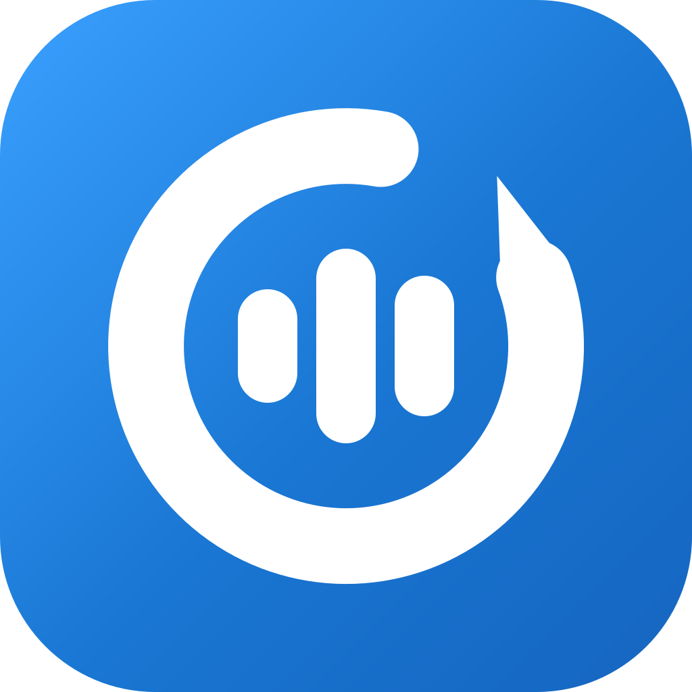

<div align="right">
  <a href="./README.en.md">English</a> | <strong>简体中文</strong>
</div>

<div align="center">
  

  <h1>LoopBack — 英语听说训练 App</h1>

  <p><strong>选一段想听懂的音频，从精听到复述，把它真正练透。</strong></p>

  <p>精听 · 跟读 · 盲听 · 复述 · 间隔复习，LoopBack 自动安排每一步，你只负责练。</p>

  <p>
    <a href="./LICENSE"></a>
    
    <a href="https://github.com/iron6909/loop-back/releases/latest"></a>
    <a href="https://github.com/iron6909/loop-back/releases"></a>
    <a href="https://github.com/iron6909/loop-back/commits/main"></a>
  </p>

</div>

---

## ⚖️ 项目来源与许可

LoopBack 是开源项目 [Echo Loop](https://github.com/echo-loop/Echo-Loop)（GNU AGPL-3.0）的修改版本，修改始于 2026 年 11 月，主要改动包括：

- 品牌更名为 LoopBack：应用名、包名、图标、数据库与本地文件全部改名；
- 去云端化：账号、会员结账、云端字幕、社区同步、网盘导入与自更新已停用；
- AI 改为用户自配供应商直连（OpenAI 兼容接口），费用由供应商按其套餐或用量计费；
- 语音识别、语音合成、词典与发音库改从公开源下载（Hugging Face 等），不再依赖 Echo Loop 资源服务；
- 不再上架应用商店，通过 GitHub Releases 分发 Android APK。

依据 AGPL-3.0，本项目整体继续以 AGPL-3.0 许可，完整许可文本见 [LICENSE](./LICENSE)；对上游代码的改动与新增代码均在本仓库公开。感谢 Echo Loop 的开发者与社区。

---

## 📖 LoopBack 是什么

LoopBack 是一款开源的英语听说训练 App。导入一段音频——播客、TED、剧集或教材都可以——它带你依次完成**精听 → 跟读 → 盲听 → 复述**，再按**间隔复习**在遗忘前巩固，直到一段材料真正内化。

大多数材料类 App 只提供内容和工具，"怎么练"要自己安排。LoopBack 把这个环节自动化：今天练哪段、听几遍、什么时候看字幕、哪句该反复跟读、什么时候复习，都由 App 决定。你不需要做计划，打开就能开始。

学习过程全程量化：**学习时长 · 输入输出比 · 唯一词汇量**，练了多少、说了多少一目了然。

---

## 📱 截图

<table>
  <tr>
    <td align="center"><br/><sub>导入音频，开始练习</sub></td>
    <td align="center"><br/><sub>学习计划，听说闭环</sub></td>
    <td align="center"><br/><sub>复习提醒，自动安排</sub></td>
    <td align="center"><br/><sub>逐句精听，难点标注</sub></td>
    <td align="center"><br/><sub>句子讲解，意群划分</sub></td>
  </tr>
  <tr>
    <td align="center"><br/><sub>段落复述，说出理解</sub></td>
    <td align="center"><br/><sub>难句收藏，集中重练</sub></td>
    <td align="center"><br/><sub>闪卡复习，原句重现</sub></td>
    <td align="center"><br/><sub>随心听，自由练习</sub></td>
    <td align="center"></td>
  </tr>
</table>

---

## ✨ 功能

- **自动驱动的学习节奏**：跟读次数、复习时机、难句标记自动推进，专注听和说即可。
- **听说闭环**：精听、跟读、复述一条流程走完——先听懂，再模仿，最后用自己的话说出来。
- **长难句意群划分**：长句按意群切分，复杂句拆开理解。
- **难句收藏与专项复习**：练过的难句自动归档，可集中重练，避免"标了就忘"。
- **语境化闪卡复习**：收藏的单词和意群结合原句上下文复习，在语境中记忆。
- **AI 翻译、解析与词汇讲解**：双语翻译、句子解析、单词用法与搭配，按需展开，不打断练习。
- **断点续学**：自动记录学习阶段与当前句子，碎片时间也能接着练。
- **学习数据统计**：记录学习时长、输入输出比、唯一词汇量。
- **跟读评测**：本机识别结果与原句对齐，高亮命中词并给出评级。
- **本地音频导入 + 字幕**：批量导入本地音频，可带本地字幕，也可用本机模型转录生成。

---

## 🔌 AI 服务与本地化说明

AI 功能使用用户自行配置的供应商，首次使用请到「设置 → AI 服务」选择 DeepSeek、OpenRouter 或自定义 OpenAI 兼容地址，填写模型与 API Key 并手动验证连接。Base URL 直接追加 `/chat/completions`，不会自动补 `/v1`。密钥仅存设备安全存储，不进入备份，恢复备份后需重新填写。

字幕与复述录音转写使用本机英语模型完成；学习助手与讲解请求由当前供应商处理。账号、会员、云端字幕、社区同步、网盘导入与自更新已停用；历史学习数据保留，本地目录可导入为合集，精选播客随包提供。

---

## 🧠 学习方法

**精听 → 跟读 → 盲听 → 复述 → 科学间隔复习 → 通关。**


每段素材 = 1 次首次学习 + 7 轮间隔复习，间隔从 6 小时逐步拉长到 28 天：

| 阶段 | 距上次间隔 | 任务 |
|---|---|---|
| 首次学习 | — | 精听 → 跟读 → 盲听 → 段落复述 |
| 首轮复习 | 6 小时后 | 难句补练 + 段落复述 |
| 第二轮复习 | 1 天后 | 盲听 + 难句补练 + 段落复述 |
| 第三轮复习 | 2 天后 | 盲听 + 难句补练 + 段落复述 |
| 第四轮复习 | 4 天后 | 盲听 + 难句补练 + 段落复述 |
| 第五轮复习 | 7 天后 | 盲听 + 难句补练 + 段落复述 |
| 第六轮复习 | 14 天后 | 盲听 + 难句补练 + 段落复述 |
| 第七轮复习 | 28 天后 | 盲听 + 难句补练 + 段落复述 |

---

## 🆚 与其他方案的差异

和其他英语学习 App 相比，LoopBack 的不同在于：**它把每一步串成流程自动驱动，不需要自己定计划、数遍数、记复习时间。**

| 功能 | LoopBack | 每日英语听力 | 可可英语 | 英语流利说 | Anki |
|---|---|---|---|---|---|
| 学习节奏由 App 驱动 | ✅ 全自动 | ❌ | ❌ | ❌ | ❌ |
| 精听 + 跟读 + 复述闭环 | ✅ | ⚠️ 部分支持 | ⚠️ 部分支持 | ⚠️ 部分支持 | ❌ |
| 长难句意群划分 | ✅ | ❌ | ❌ | ❌ | ❌ |
| 收藏句专项复习 | ✅ | ❌ | ❌ | ❌ | ❌ |
| 语境化闪卡复习 | ✅ | ❌ | ❌ | ❌ | ⚠️ 需手动建卡 |
| AI 翻译 / 句子解析 / 词汇讲解 | ✅ | ⚠️ 部分支持 | ⚠️ 部分支持 | ❌ | ❌ |
| 断点续学 | ✅ | ⚠️ 部分支持 | ⚠️ 部分支持 | ⚠️ 部分支持 | ⚠️ 部分支持 |
| 学习数据统计 | ✅ | ⚠️ 部分支持 | ⚠️ 部分支持 | ⚠️ 部分支持 | ❌ |
| 跟读评测 | ✅ | ✅ | ✅ | ✅ | ❌ |
| 导入本地音频 | ✅ | ✅ | ❌ | ❌ | ⚠️ 需自制卡片 |
| 离线可用 | ✅ | ✅ | ✅ | ⚠️ 部分支持 | ✅ |
| 开源 | ✅ | ❌ | ❌ | ❌ | ✅ |

---

## 📥 下载与试用

本项目不上架应用商店。Android 请从 GitHub [Releases](https://github.com/iron6909/loop-back/releases) 下载 APK 侧载安装；iOS / macOS / Windows 以源码构建为准（桌面端开发中，Web 暂无计划）。

---

## ❓ 常见问题

<details>
<summary><strong>LoopBack 免费吗？</strong></summary>

核心功能免费且不限量：导入素材、收藏、完整学习闭环与 7 轮间隔复习、难句专项复习、语境闪卡、本机跟读评测与离线转录、离线词典、数据统计、PDF 导出、备份与恢复。

AI 讲解与学习助手走你配置的供应商接口，由供应商按其套餐或用量计费；本项目不提供免费 AI 额度或会员结账。

</details>

<details>
<summary><strong>哪些功能会调用供应商 AI？</strong></summary>

AI 翻译、句子解析、意群拆分、词汇解析、学习助手与复述评估会请求当前供应商。字幕生成与复述录音转写使用本机英语识别模型，录音不上传。

</details>

<details>
<summary><strong>供应商余额或套餐不足时怎么办？</strong></summary>

本地学习不受影响。到供应商控制台查看套餐与余额，或在「设置 → AI 服务」切换配置；应用内不办理充值或续订。

</details>

<details>
<summary><strong>API Key 会进入备份吗？</strong></summary>

不会。Key 仅存设备安全存储，不写入日志、偏好、备份或埋点；恢复备份后需重新填写。供应商地址、模型等非敏感配置会随备份。

</details>

<details>
<summary><strong>支持哪些平台？</strong></summary>

目前主力是 Android（GitHub [Releases](https://github.com/iron6909/loop-back/releases) 侧载 APK）。iOS 与桌面端以源码构建为准，后续完善发布。

</details>

<details>
<summary><strong>支持哪些学习材料？</strong></summary>

- 音频：mp3、m4a、wav、aac、flac
- 视频：mp4、mov、m4v、mkv（可隐藏画面当音频练）
- 字幕：srt、vtt、lrc，与音频同名自动配对；没有字幕可用 AI 转录生成
- 来源：本地文件、Android 文件夹、音频直链、播客订阅

建议选感兴趣、难度略高于当前水平的内容。

</details>

<details>
<summary><strong>需要什么英语基础？</strong></summary>

能借助字幕看懂材料大意就可以开始。听不懂的句子可以用意群拆分、翻译和解析辅助；基础薄弱先从慢速短篇练起。

</details>

<details>
<summary><strong>多久能看到效果？</strong></summary>

一段素材完成首次学习后就能听懂并复述；之后 7 轮间隔复习持续约 8 周，把它变成长时记忆。整体提升靠积累：每天 20～30 分钟、同时练 2～3 段素材，几周后通常能感到听得更轻松、说得更顺。

</details>

<details>
<summary><strong>没有网络能用吗？</strong></summary>

可以。学习流程、复习、收藏、跟读评测、本地转录都可离线；供应商 AI、播客内容与模型首次下载需要联网。

</details>

<details>
<summary><strong>学习数据存在哪里？换手机怎么办？</strong></summary>

数据默认存本机。换手机或重装前，在「设置 → 备份与恢复」导出备份，到新设备恢复。

</details>

---

## 🗺️ Roadmap

- ✅ 学习闭环：精听 / 跟读 / 盲听 / 复述 + 7 轮间隔复习（6h → 28d）
- ✅ 意群划分、难句收藏与专项复习、语境化闪卡
- ✅ AI 翻译 / 解析 / 查词 / 学习助手（供应商直连）
- ✅ 本机语音识别、语音合成与离线词典（公开源模型）
- ✅ 断点续学、学习统计、备份与恢复
- 🚧 AI 口语陪练
- 🚧 macOS / Windows 桌面端正式发布
- 🔭 官方精选合集（按主题与难度分级）、自定义任务流

---

## 🧑‍💻 给开发者

<details open>
<summary><strong>🚀 快速开始</strong></summary>

```bash
git clone git@github.com:iron6909/loop-back.git
cd loop-back
cp .dev.env.template .dev.env   # 填入渠道/分析等编译期变量（无自有后端 API）
flutter pub get
dart run build_runner build
flutter run -d <ios|android|macos> --dart-define-from-file=.dev.env
```

> 编译期配置放在 `.dev.env`（调试）/ `.prod.env`（发布），通过
> `--dart-define-from-file` 注入。这两个文件已被 `.gitignore`，请勿提交。
> 项目已无自有后端 API 与资源 CDN，无需配置任何服务端点。

</details>

<details>
<summary><strong>🤝 如何贡献</strong></summary>

欢迎提 Issue / PR。提交前请运行：

```bash
flutter analyze
flutter test
```

Commit 标题遵循 `PREFIX: 内容` 格式（参考 `git log` 常用前缀，如 FEAT / FIX / DOCS / MOD / OPT / CHORE / CI / RELEASE 等）。

</details>

<details>
<summary><strong>🛠️ 技术栈</strong></summary>

| 类别 | 技术 | 用途 |
|------|------|------|
| UI 框架 | Flutter + Material 3 | 跨平台 UI |
| 状态管理 | Riverpod（代码生成） | 单向数据流 |
| 音频播放 | just_audio + audio_session | 音频引擎层 |
| 语音识别 / 合成 | sherpa_onnx（Whisper / Kokoro / Piper） | 本机识别与 TTS |
| 字幕解析 | subtitle | SRT/VTT |
| 数据持久化 | Drift (SQLite) + shared_preferences | 学习进度、收藏、缓存 |
| 国际化 | flutter_localizations + ARB | 简体中文 / English |
| 测试 | flutter_test + mocktail | 单元 / Widget / 集成 |
| 静态分析 | flutter_lints | 代码规范 |

</details>

<details>
<summary><strong>⌨️ 开发命令速查</strong></summary>

**运行**

```bash
flutter run -d ios            # iOS
flutter run -d android        # Android
flutter run -d macos          # macOS（开发中，未发布）
flutter run -d chrome         # Web（仅调试用，无发布计划）
```

**测试 / 质量检查**

```bash
flutter analyze                          # 静态分析
flutter test                             # 全部测试
flutter test integration_test -d macos   # 集成测试
# Maestro UI 烟测（先启动设备并安装开发包；Android 开发包示例）
MAESTRO_APP_ID=app.loopback.dev scripts/test_maestro.sh
# Android 真机：自动构建、安装 dev 包并运行 Study 测试
scripts/test_maestro_android.sh
# 多台设备时显式指定目标
scripts/test_maestro_android.sh --device <adb-serial>
dart format .                            # 格式化
```

> Maestro CLI 安装：`curl -fsSL https://get.maestro.mobile.dev | bash`。iOS 开发包请将
> `MAESTRO_APP_ID` 改为 `top.loop-back.dev`；测试流存放在 `maestro/`。

**代码生成**（修改 Riverpod Provider 后）

```bash
dart run build_runner build
```

**构建**

```bash
flutter build apk --dart-define-from-file=.prod.env
```

> 发布脚本 `scripts/release_*.sh` 已内置 `--dart-define-from-file`，无需手动传参。

**环境要求**

- Dart SDK ^3.9.2（见 `pubspec.yaml`）
- iOS 模拟器 / Android 模拟器 / 真机
- 桌面端：macOS / Windows / Linux 开发环境

</details>

---

## 🙏 致谢

LoopBack 派生自 [Echo Loop](https://github.com/echo-loop/Echo-Loop)（AGPL-3.0），感谢其开发者与社区对学习方法设计与工程实现的开源贡献。

核心依赖：

- 音频与语音：[just_audio](https://pub.dev/packages/just_audio) · [audio_session](https://pub.dev/packages/audio_session) · [flutter_tts](https://pub.dev/packages/flutter_tts) · [sherpa_onnx](https://pub.dev/packages/sherpa_onnx)
- 数据与状态：[drift](https://pub.dev/packages/drift) · [flutter_riverpod](https://pub.dev/packages/flutter_riverpod)
- 文本处理：[subtitle](https://pub.dev/packages/subtitle) · [lemmatizerx](https://pub.dev/packages/lemmatizerx)
- 系统能力：[file_picker](https://pub.dev/packages/file_picker) · [flutter_local_notifications](https://pub.dev/packages/flutter_local_notifications)

---

## 📄 License

[AGPL-3.0](./LICENSE)
