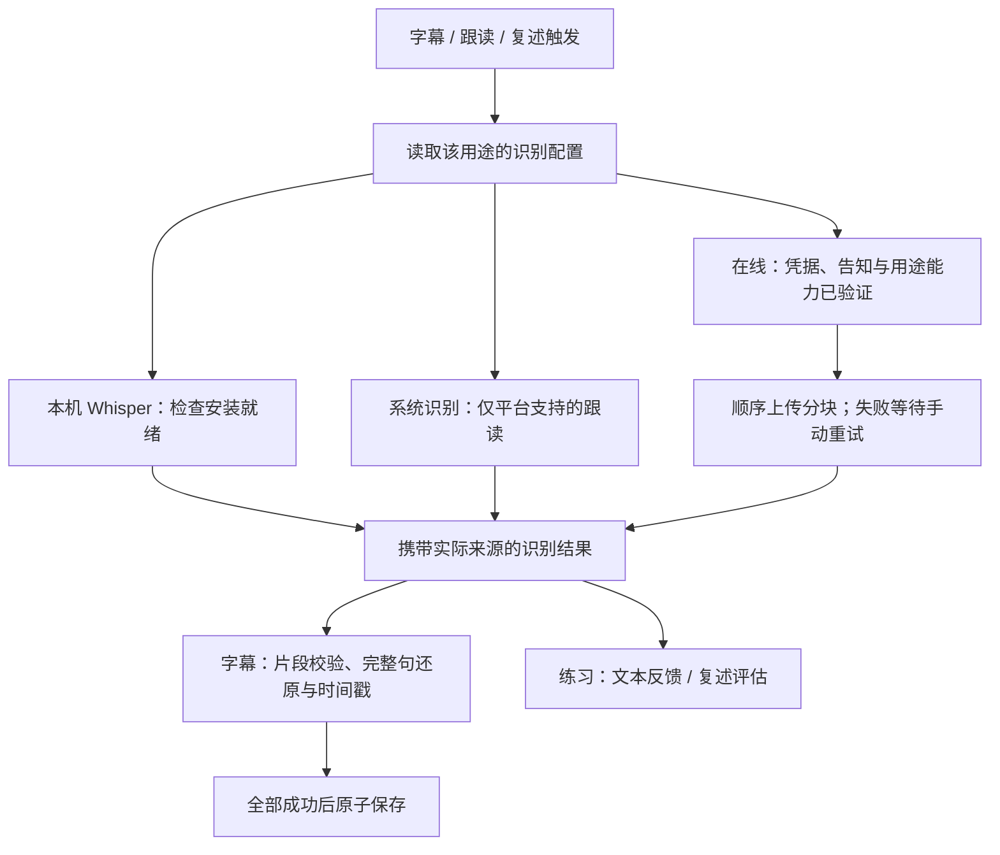

# 语音识别去 EchoLoop 化方案

> 定稿：2026-11-07。官方资料与代码事实核查：2026-11-06 至 2026-11-07。
> 状态：D1–D13 已经两轮“全部按建议”确认，方案已定稿；业务代码尚未实施。
> 文档入口：[正式规格](./spec.md) · [实施任务与验收](./implementation.md) · [术语](../../../GLOSSARY.md) · [配置与凭据隔离 ADR](../../adr/0001-separate-speech-and-text-provider-config.md)。

本次交付目标是：保留公开 Whisper 本地识别，解除 ASR/VAD 对 EchoLoop 品牌及资源 CDN 的必需依赖；新增用户配置的 OpenRouter / OpenAI 兼容在线转写。字幕、跟读、复述分别选择识别方式和模型，数据迁移保持已有模型、字幕与学习记录。

所有产品选择均已确定。具体模型资源的重新下载校验、线上模型兼容性和设备性能属于实施验证，不是尚未决定的产品范围。

## 目标与现状

用户目标：本地语音识别使用可公开获取的模型，并支持用户配置在线语音识别服务，解除语音识别对原产品 EchoLoop 的绑定。

关键事实：三个现有模型已经是 Whisper，Echo Loop AI 是界面名称。最小改造方向是公开模型身份、迁移资源分发、增加在线转写入口；更换推理引擎不是达到目标的必然条件。

| 当前显示名称 | 实际模型 | 内部 ID | 当前压缩包体积，约 |
| --- | --- | --- | --- |
| Echo Loop AI (Fast) | Whisper tiny.en，INT8 ONNX | `whisper-tiny-en-int8` | 62.3 MB |
| Echo Loop AI (Balanced) | Whisper base.en，INT8 ONNX | `whisper-base-en-int8` | 95.1 MB |
| Echo Loop AI (Accurate) | Whisper small.en，INT8 ONNX | `whisper-small-en-int8` | 228.2 MB |

这些体积来自现有 ZIP catalog，不代表公开上游逐文件下载量、安装体积或运行内存。三者由 sherpa-onnx 执行；公开权重与运行引擎是不同概念，不能把原始 Whisper 权重、ONNX 和 whisper.cpp 的模型格式直接互换。

### 仓库证据

- [asr_model_manager.dart](../../../lib/services/asr/asr_model_manager.dart)：105 行起明确给出品牌名与 Whisper ID 映射；模型保存于 `ApplicationSupport/asr-models/<id>`。未知模型 ID 目录会被清理，因此改名不应改 ID。
- [asr_model_catalog.dart](../../../lib/services/asr/asr_model_catalog.dart)：固定 ZIP 路径、归档 SHA-256、所需文件；三个模型都声明依赖 `silero-vad`。
- [upload_asr_models_to_r2.sh](../../../scripts/upload_asr_models_to_r2.sh)：55 行起记录 `csukuangfj/sherpa-onnx-whisper-{tiny,base,small}.en` 的 Hugging Face revision 和文件 SHA-256。它是上游出处证据，不能据此声称已重新下载并验证全部权重。
- [regional_service_endpoints.dart](../../../lib/config/regional_service_endpoints.dart)：模型分发仍使用 `cdn.echo-loop.top` / `cdn.echo-loop.cn`。词典、发音库、Kokoro 和 Piper 也复用该资源路由，ASR 去耦不能直接删除共享 CDN 配置。
- [resource_install_manifest.dart](../../../lib/services/resource_install_manifest.dart)：安装清单记录资源 ID、安装时间和体积。改分发方式需保留现有完整性校验与安装成功语义，不能只替换 ZIP URL。

### 三条业务链路

| 用途 | 当前路径与配置 | 结果要求 |
| --- | --- | --- |
| 学习材料字幕 | `LocalTranscriptionTaskManager` → 16 kHz WAV → 专用 Sherpa 引擎；偏好 `local_transcription_model_id` | 有时间位置的片段；当前词级时间戳为合成值 |
| 跟读 | 平台录音后端；Android 默认离线、Apple 默认平台识别；偏好 `offline_asr_selected_model_id` | 文本用于覆盖率等反馈；Apple 还可能提供实时文本，离线在停录后识别 |
| 复述 | 优先使用同 attempt 的有效转写，否则 `RetellTranscriber` 独立本机识别；目前复用字幕模型选择 | 文本；成功转写后才请求文字 AI 做复述评估 |

对应文件：[local_transcription_task_provider.dart](../../../lib/providers/local_transcription_task_provider.dart)、[local_transcription_model_provider.dart](../../../lib/providers/local_transcription_model_provider.dart)、[speech_recording_controller.dart](../../../lib/providers/speech/speech_recording_controller.dart)、[offline_asr_settings_provider.dart](../../../lib/providers/offline_asr_settings_provider.dart)、[retell_review_evaluation_provider.dart](../../../lib/providers/retell_review_evaluation_provider.dart)、[retell_transcriber.dart](../../../lib/services/retell_transcriber.dart)。

字幕使用 Whisper 原生片段时间戳和长音频滑窗，不使用 VAD；独立复述转写也不传 VAD 路径。但安装就绪检查仍要求共享 VAD，练习录音还经过平台原生录音链路。更换模型名称或下载源不等于修复既有 Android native/VAD 崩溃。

## 外部能力核查

以下是 2026-11-06 的官方文档与公开目录证据，不是付费转写实测。

### 本地模型

- [OpenAI Whisper](https://github.com/openai/whisper/)：代码及模型权重为 MIT 许可；提供 tiny.en、base.en、small.en 等英语模型。
- [Sherpa 官方 Whisper ONNX 分发说明](https://k2-fsa.github.io/sherpa/onnx/pretrained_models/whisper/export-onnx.html)：列出对应的 Hugging Face ONNX 仓库及镜像入口。转换产物、运行库、VAD 的来源、版本和许可需要各自记录，不能用 Whisper 的许可替代全部依赖声明。
- 已确认继续使用当前三种 ONNX 模型和现有引擎。模型名称采用 Whisper Tiny / Base / Small（English），速度/资源说明作辅助描述。

### OpenRouter

[官方 STT 文档](https://openrouter.ai/docs/guides/overview/multimodal/stt) 已明确：

- 专用端点为 `POST https://openrouter.ai/api/v1/audio/transcriptions`。
- 支持 JSON `input_audio` 和 OpenAI 风格 `multipart/form-data`。因此不能根据旧印象断言 OpenRouter 只有音频聊天接口，也不必默认引入两套完全不同的上传协议。
- `verbose_json` 可请求结构化片段；`timestamp_granularities` 可请求 segment / word。实际字段及支持程度取决于供应商和具体模型，有些模型会拒绝 `verbose_json`。
- 不接受直接请求 SRT/VTT 输出；应由客户端将通过校验的时间片段转换成项目已有字幕结构。
- multipart 上限为 25 MB；官方建议长音频分块以避免上游处理超时。不能把本地 Whisper 的 30 秒推理窗口直接当成在线服务限制，也不能只按文件体积判定可用。
- 通过 `GET /api/v1/models?output_modalities=transcription` 发现 STT 模型。已对这一公开端点执行只读请求，返回包含 `openai/whisper-large-v3`、`openai/whisper-large-v3-turbo`、`openai/whisper-1` 等条目。目录存在不证明鉴权、时间戳或质量已验收。

已确认首期实现专用文件转写协议；普通多模态聊天模型不自动进入字幕模型列表。OpenRouter 是服务入口，Whisper Large V3 等是模型，两者分别配置和展示。

### 模型生命周期

[OpenAI 文件转写指南](https://developers.openai.com/api/docs/guides/speech-to-text) 当前标明其 `whisper-1`、`gpt-4o-transcribe` 等旧 API 模型计划于 2027-02-26 下线。因此不建议把 `whisper-1` 固化成长期唯一线上选项。

此公告针对 OpenAI 服务，不代表本地开源 Whisper 权重失效，也不等于 OpenRouter 上其他供应商的 Whisper Large V3 同日停用。线上模型应允许手填/替换，预设在实施时重新核对。

## 已确认范围（D1–D6）

第一轮由用户回复“全部按建议”确认。

| 编号 | 已确认问题 | 决定 |
| --- | --- | --- |
| D1 | 本地去耦是否覆盖品牌与整个 ASR 资源分发，且继续使用现有公开模型？ | 保留三种 Whisper ONNX 和 sherpa-onnx，移除 EchoLoop 品牌及 ASR/VAD 对 EchoLoop CDN 的必需依赖；保留 ID、已安装模型和学习数据 |
| D2 | 在线识别是否首期覆盖全部三类用途？ | 覆盖字幕生成、跟读停录后的转写、复述转写；实时识别暂沿用现有平台能力，不把文件转写宣称为实时识别 |
| D3 | 首期在线接入范围如何界定？ | OpenRouter 预设 + 通用 OpenAI 兼容 `/audio/transcriptions` 自定义端点；语音模型配置与文字 AI 模型配置分开；不逐家接入专有 SDK |
| D4 | 默认处理位置与失败降级如何选择？ | 新装保持当前默认：字幕/复述本机，跟读按平台；升级保留有效选择。只有用户主动选择新增在线服务时才向该服务上传音频；本地失败不自动上传，在线失败不自动换供应商或模型计费。系统语音识别单独描述，不视为纯离线保证 |
| D5 | 是否继续只支持英语学习材料和英语练习录音？ | 首期仍为英语；多语言及语言自动识别另列后续需求 |
| D6 | 首期验收是否延续现有平台边界？ | Android 真机优先；保持 iOS/macOS 可编译和现有功能，正式宣称这些平台在线可用前补实机证据；不扩展 Windows/Linux/Web |

## 已确认行为（D7–D13）

第二轮由用户回复“全部按建议”确认。以下行为与 D1–D6 共同构成实施契约。

| 编号 | 已确认问题 | 决定 |
| --- | --- | --- |
| D7 | 公开下载的网络兜底 | 内置公开上游与一个明确标识的镜像，用户可切换；两者使用同一固定版本和文件 SHA-256。首期只通过下载管理器安装，不新增手动模型文件导入或任意下载 URL |
| D8 | 按用途配置与凭据 | 在“语音识别”设置中，为字幕、跟读、复述分别选择方式和模型；首期共用一份在线语音服务地址/Key，三个用途可选择不同在线模型。语音 Key 与文字 AI 独立保存，用户可填写相同 Key，但不建立自动共享关系 |
| D9 | 字幕模型准入 | 在线字幕只接受具有可验证片段时间戳的模型；纯文本模型仍可用于跟读和复述。片段有效而词时间戳缺失时，沿用明确标记的合成词级时间戳；首期不加额外对齐模型，也不接入只有词时间戳的字幕模型 |
| D10 | 模型选择与能力验证 | 模型 ID 始终允许手填；OpenRouter 可手动刷新 STT 列表。配置可先保存，启用在线用途前，用户手动用随包短音频完成对应能力测试；文字成功与字幕时间戳成功分别展示，地址/Key/模型变更后旧验证失效 |
| D11 | 上传与费用提示 | 首次启用某在线语音服务时说明上传对象和供应商收费，并由用户确认；后续每次操作显示所用方式/模型，不重复弹窗。显示供应商返回的实际用量/费用，没有数据时标记未知；不承诺预估价或退款，不自动重试可能已计费的请求 |
| D12 | 长音频、重试与后台边界 | 顺序分块；失败时保留本次进程内已完成块，用户只重试失败/未完成部分。全量成功后一次性保存字幕。关闭弹窗或返回其他页面可继续，暂不承诺系统后台持续运行、应用被杀后的断点恢复；主动取消则结束任务并清理临时结果 |
| D13 | 改模型后如何处理已有任务和结果 | 修改某用途选择、所用服务地址/Key，或清除凭据时，取消绑定旧配置的进行中任务。已保存字幕/练习结果保留，不自动付费重跑；用户显式“重新识别”才创建新任务 |

### 设置结构

```text
语音识别
  本地模型
    Whisper Tiny / Base / Small（English）
    下载来源：公开上游 / 镜像
  在线语音服务
    OpenRouter / 自定义兼容接口
    地址、API Key
  识别用途
    学习材料字幕：本机 / 在线 + 对应模型
    跟读录音：本机 / 系统（平台支持时）/ 在线 + 对应模型
    复述录音：本机 / 在线 + 对应模型
```

保留现有字幕弹窗的模型选择便利性，展示当前用途的选择，而不是另建一份互不联动的状态。新装本地模型沿用当前 Base 默认；迁移保留原字幕和跟读偏好，复述的独立识别初值取升级前的字幕模型。既有同次录音结果可继续展示，不能为了迁移而自动重识别。

D9 采用较窄的首期准入，以复用现有字幕片段管线。只有词时间戳的模型可以保存配置、用于文本转写，但暂不能启用字幕用途；这是产品能力限制，不表示服务无法识别语音。

D10 的测试是一次可能计费的真实转写，使用随包的非用户录音；测试成功只证明该配置在样本上的能力，每次正式结果仍要校验。列表刷新不视为转写测试。相同在线模型被多个用途使用时，复用已取得的适用验证结果；不为每个用途重复发送同样的测试请求。

D12 中网络超时可能发生在供应商已完成识别之后，因此“只重试失败块”仍可能对该块重复收费。重试由用户触发并说明这一点；已成功块不重复发送。切换配置依 D13 取消旧任务，不能将不同配置产生的块直接拼成一次新任务。

### 目标数据流



在线分支不要求下载本地模型或 VAD；只有切换到本机方式时才执行模型安装门控。在线失败不隐式进入本机、系统或另一供应商分支。

## 配置、结果与迁移契约

### 配置的单一来源

- 每个识别用途保存所选方式、本机模型 ID、在线模型 ID。切换方式不丢失另一方式的模型选择；设置页与字幕入口读写同一状态。
- 全部在线语音用途共用一份服务类型和 Base URL，以及一份独立安全 Key。Base URL 直接追加 `/audio/transcriptions`，不自动补 `/v1`；OpenRouter 预设根路径为 `https://openrouter.ai/api/v1`。
- 语音与文字 AI 的配置、请求生命周期和 Key 清除相互独立；同一 Key 可以由用户分别填写。详见[ADR](../../adr/0001-separate-speech-and-text-provider-config.md)。
- 每次识别捕获输入/attempt、用途、方式、模型和配置版本。结果携带实际识别身份；本机结果不得标成当前设置中的在线模型，旧配置的分块结果不得用于新配置任务。
- 能力验证记录绑定非秘密配置身份，本机保存，正常重启可以复用；配置变化使相关结果失效。Key 不参与普通存储里的摘要或身份计算，凭据变更用独立版本标识使验证失效。备份不携带验证记录，恢复后重填 Key 并重新测试。
- 上传/收费告知发生在第一次测试请求之前。测试使用随包短音频，正式任务上传用户材料或录音；告知涵盖所选服务及其实际推理供应商。新服务地址需重新告知，后续同服务正常操作不反复确认。

### 结果准入与来源

- 文本用途要求有效的非空转写；字幕用途额外要求片段数组及有效时间。时间必须为有限数值且位于对应音频范围内，片段顺序和起止关系合法；浮点舍入容差由解析器集中处理并测试，不能把大范围越界“修正”为成功。
- 返回空文本/空片段不覆盖已有字幕。长材料中经本机能量检查确认无声的块可跳过；有声或无法确定的块返回空结果视为失败，不能静默漏掉内容。整份材料没有可用语音时显示无可识别语音。
- 保留服务返回的有效词时间戳；缺失或无法与片段文本有效对应时，对受影响片段使用现有合成方法并记录估算来源。完整句还原只在必要的句内切分处估时，不把估时标成模型逐词对齐。
- `TranscriptSource` 既有 local=0、ai=1、device=2 保持不变，追加 online=3 表示本次新增的用户供应商转写。历史 ai 还用于随包示例，不能统一重解释为当前在线请求。
- 当前 `WordTimestamp` 和表字段没有可复用的来源标记。新增可空的字幕整体词时间戳来源：模型提供、估算、混合；null 表示历史未知。界面依据来源字段提示，不能认为 `online` 必然具有模型提供的词级对齐。
- 在最新数据库版本上新增必要字段和迁移；历史数据保留原内容和来源值。未知来源不宣称精确；新版本备份仍遵守既有高版本不得导入低版本的规则。

### 迁移规则

| 原状态 | 升级后的处理 |
| --- | --- |
| 已安装三种 Whisper / VAD 且有效 | 保留目录、ID 和安装结果；切公开源不强制重下 |
| 历史逐文件安装 | 复用兼容校验，成功后写统一安装清单；失败仅提示修复，不先删可用数据 |
| 跟读已有有效后端/模型偏好 | 保留；Android/Apple 默认规则仅用于未设置情况 |
| 字幕已有模型偏好 | 保留；未保存时沿用原初始化语义 |
| 复述没有独立偏好 | 初始化为本机，模型取升级前解析出的字幕模型；不重识别已完成录音 |
| 尚无在线语音配置 | 保持现有本机/系统方式，不复制文字 Key 或自动发请求 |
| 备份恢复包含在线选择但无 Key/验证 | 显示该用途需要重新配置，不自动上传、测试或切换方式；用户可手动改本机 |
| 历史字幕及学习数据 | 原内容保留，来源整数不重排；只有显式重新识别并完整成功提交才更新 |

线上模型 ID 不与本机模型 ID 互相转换，不根据 Fast/Balanced/Accurate 文案推断缓存身份。仅修正识别模块中的品牌名称，整款应用的更名及其他资源去耦不在本次范围。

## 现有实现约束

- 当前只有字幕和练习两份模型偏好，复述的独立识别复用字幕模型；`retell_player_screen.dart` / `retell_review_evaluation_provider.dart` 会优先使用已有转写。增加复述配置时必须同时处理录音路由和结果来源，不能显示选了在线模型却仍无条件复用别的模型结果。
- 同 attempt 的转写复用还应匹配实际识别方式、模型和相关配置；配置变更后不能把旧转写冒充新模型结果。评估缓存继续按实际文本等既有身份取用，不为相同文本无条件新增重复收费请求。
- `provider_config_store.dart` 当前只有一个普通配置槽和一个安全 Key 槽，地址/type 改变会清 Key；不能把 ASR 配置直接写入文字 AI 的槽。复用实现规则而非共享这份可变状态，备份恢复必须覆盖两份凭据的清除和失败回滚。
- `LocalTranscriptionTaskManager` 是 keepAlive 的内存任务表，既没有分块检查点，也没有进程恢复；本地引擎的 30 秒采样窗口不等于可上传音频文件的切片能力。
- `audio_transcode_service.dart` 已有压缩音频和 PCM WAV 转换，但未接通在线上传管线，也没有区间切片/会话取消参数。在线分块需要补有界的文件提取及相应取消能力，不能承诺现成可用。
- 现有字幕文件和词时间戳写库后才更新条目元数据，整条操作未处于同一事务，最终写入前还需补有效性复查。新流程必须在提交边界一次写入字幕、词时间戳和转录元数据；取消在提交开始前阻止写入，提交开始后以原子完成结果为准，不显示“已取消”却已覆盖成功。
- 字幕任务归任务管理器所有，可以跨页面继续；录音请求归当前练习会话所有。不能用“关闭页面就取消所有任务”的统一规则破坏既有字幕跨页面运行的行为。
- 仓库尚未给出与现有 VAD SHA 对应的固定公开源；实施 I1 必须补齐来源、许可与兼容性证据。若公开版本需要升级，明确记录版本变化并验证设备行为，不能伪称只改下载地址。

## 实施顺序

### 1. 本地身份和分发去耦

- 先明确模型显示名、出处和许可，保持原 ID 与偏好。保留本地缓存，避免重新下载全部权重。
- 新安装从固定 revision 的公开上游取得完全匹配的 encoder / decoder / tokens；VAD 也须有独立公开来源和固定摘要。
- 当前安装器面向 ZIP；公开源可能是单文件或不同归档格式。应复用下载、SHA 校验、临时目录、失败清理与原子替换能力，针对实际资源形态作最小适配，不能沿用旧 ZIP 的 SHA 验证新包。
- 直接使用上游逐文件资源时，以固定版本和每文件 SHA 完成 staging 校验后才发布安装结果；成功状态仍通过统一安装清单读取。不得让新旧两种状态来源互相矛盾。
- 默认使用 Hugging Face 公开上游，提供明确标识的 `hf-mirror.com` 手动切换项；两者固定到相同 revision 和文件摘要。首期不提供模型文件导入或任意资源 URL。可达性和镜像文件一致性纳入实施验证。
- 只拆 ASR 对共享区域 CDN 的依赖；词典、TTS 等其他资源另立任务。

### 2. 在线配置与协议

- 复用现有供应商模块的安全存储、URL 校验、错误分类和配置变更作废规则；语音配置使用独立模型字段，不能覆盖翻译/讲解所选模型。
- 不直接复用只会发 `chat/completions` 的请求体。优先用已核实的 multipart 转写协议，真实差异留在服务适配处。
- 普通配置可备份，Key 不进入偏好、日志、备份或埋点；恢复后要求重新配置凭据。D8 确定两份服务独立保存 Key，允许用户填入相同值，不建立跨服务配置的自动共享引用。
- “测试连接”要实际验证小段语音转写；字幕用途还要验证时间戳能力。能访问 `/models` 或完成文字聊天不能算语音验收通过。

### 3. 接入业务与字幕处理

- 在现有调用入口按用途选择本机或在线执行；本地模型安装生命周期和 HTTP 请求生命周期分开管理，避免把在线服务硬塞进“离线模型下载”状态。
- 按 D9，首期字幕只使用服务返回的有效片段边界；只有词边界或纯文本的模型暂不准入字幕用途。纯文本不能凭均分整段时长冒充对齐结果，不引入额外对齐步骤。
- 保留已有完整句还原与短句合并逻辑。服务提供有效词级时间戳时保留；否则沿用明确标记为合成的词级时间戳，不能宣称精确逐词对齐。
- 长音频按服务上传和处理限制分块，明确块时间偏移、边界去重、不丢词、取消及失败行为。不得把半份字幕当完整成功覆盖旧字幕。
- 跟读和复述只要求文本时不强制请求时间戳。复述仅复用同 attempt 且来源与所选配置匹配的转写，识别失败停止评估；文字 AI 评分服务与语音转写服务分别处理错误。
- 切换所用模型/供应商/录音 attempt 或取消任务后，旧回调不得写库或覆盖新结果；同时取消可取消的网络请求，不能只有界面状态取消。字幕任务按管理器生命周期跨页面运行，录音请求按练习会话销毁。
- 按迁移契约追加在线转录来源和词时间戳来源字段，将字幕内容与相关元数据统一提交，并覆盖偏好/数据库备份兼容；不重写历史学习数据。

### 4. 验收后再扩大范围

| 边界 | 必须保护的行为 |
| --- | --- |
| 本地模型 | 旧三种 ID/偏好可读、旧安装继续可用、新公开源安装完整、VAD 单独缺失不会重下整模型、错误哈希/中断/取消不发布坏模型 |
| 去耦 | 隔离 EchoLoop 域名后，新安装和本地识别仍能完成；ASR 正常流程不需要该域名 |
| 在线契约 | 真正 STT 模型成功；未配置、401/402/404/429/超时/空结果/不支持时间戳均有明确状态，失败不静默换模型 |
| 字幕 | 长音频跨块时间线正确、完整句不被截断、词语不丢不重复、已有字幕不被失败结果覆盖；真实与合成时间戳不混淆 |
| 练习 | 跟读停录转写、复述同 attempt 复用、识别失败不评分、切换录音与配置后旧结果作废 |
| 凭据/备份 | 文字模型不被语音配置覆盖，Key 不入日志/备份，恢复必须重填；未选新增在线服务不向其上传 |
| 设备 | Android 实机分别验证公开源下载、本地识别、在线短录音/长字幕、取消和断网；现有 native/VAD 崩溃独立跟踪 |

每项实施任务运行定向 `flutter analyze` 与相关 unit/widget/integration 测试；UI/录音边界走 Android 真机及可用的 Maestro 流程。本方案最终接线跨录音、字幕、配置和持久化模块，整体交付时运行 `scripts/check.sh`；宿主不支持的步骤单独报告，不把未执行视为通过。具体检查分组见[实施任务](./implementation.md)。

## 预计涉及的文件

- 本地身份与安装：`lib/services/asr/asr_model_manager.dart`、`asr_model_catalog.dart`、`asr_archive_installer.dart`；`scripts/upload_asr_models_to_r2.sh` 的退役/替代说明；对应模型管理和安装测试。
- 配置与入口：`lib/screens/asr_settings_screen.dart`、`lib/providers/offline_asr_settings_provider.dart`、`local_transcription_model_provider.dart`、安装门控与下载提示；相关 ARB 及正常生成的本地化文件。
- 在线能力：参考 `lib/services/provider/` 与 `provider_configuration_provider.dart` 的现有模式添加最少必要配置、转写请求与测试；不先建通用插件框架。
- 业务接线：`local_transcription_task_provider.dart`、`speech_recording_controller.dart`、录音后端选择、`retell_review_evaluation_provider.dart` / `retell_transcriber.dart`；字幕选项和管理入口及其回归测试。
- 数据与备份：按最终配置设计检查转录来源、偏好导出、Key 过滤和恢复测试，不能只改设置界面。
- 文档：本方案、README 的模型/在线说明、TASKS。D1–D3 已确认替代旧 [本地化 spec](../20261031-local-openai-localization/spec.md) 中“ASR 模型保留原 CDN、字幕/复述只能本机”的设计约束；生效范围仅为本次 ASR 改造，其他资源 CDN 和尚未改造的运行时行为保持原状。

## 决策与验证记录

- 用户通过 grill-with-docs 调用 grilling 与 domain-modeling，先确认 D1–D6，再确认 D7–D13；两轮均回复“全部按建议”。方案据此定稿，无未决产品选择。
- 已阅读 PLAN.md、TASKS.md 及相关源文件；独立只读核查三条调用链、凭据与备份、任务生命周期和迁移影响。
- 已读取官方 Whisper/Sherpa/OpenRouter/OpenAI 资料；OpenRouter 公开 STT 模型目录请求成功。资料时点见外部能力章节。
- 此次交付为文档，未上传用户音频、读取或使用 API Key，未进行付费推理、下载全部模型或设备测试。
- 本次只进行文档相对链接、决策覆盖和 Git 差异检查，不运行 Flutter 测试或 `scripts/check.sh`；运行时测试列入实施任务。里程碑未因方案定稿而标记实现完成。
